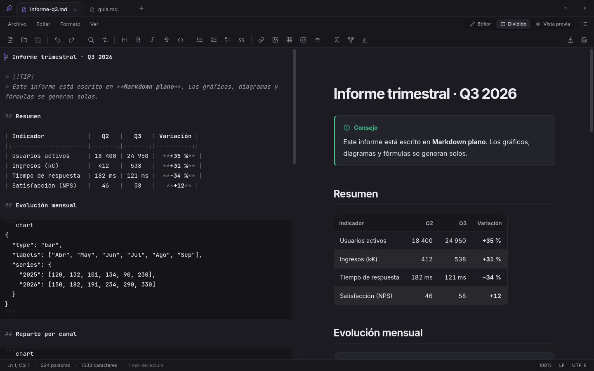
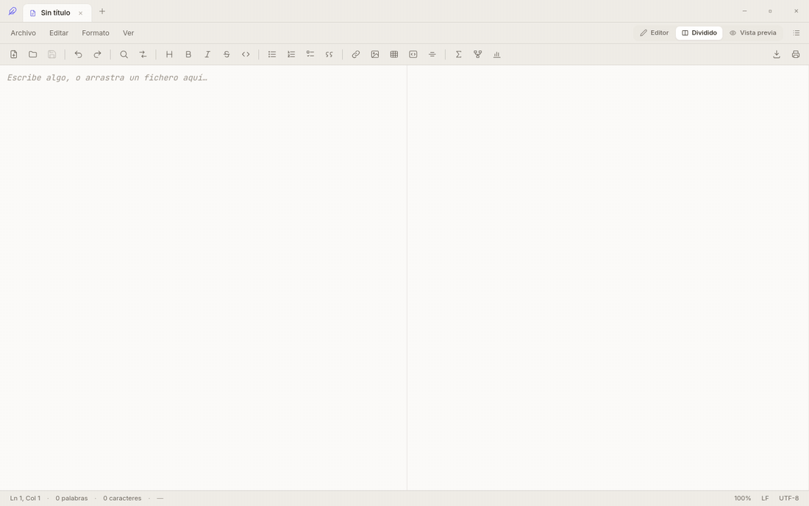
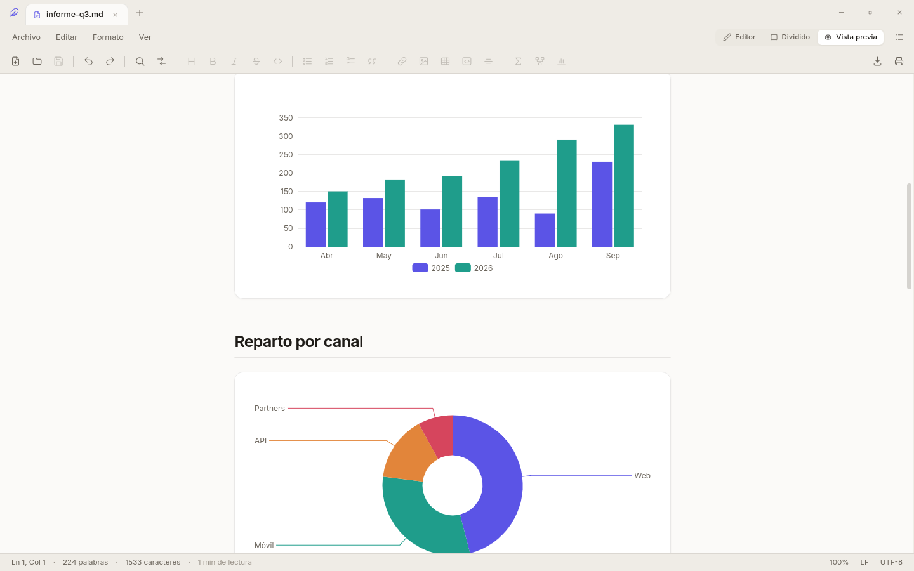
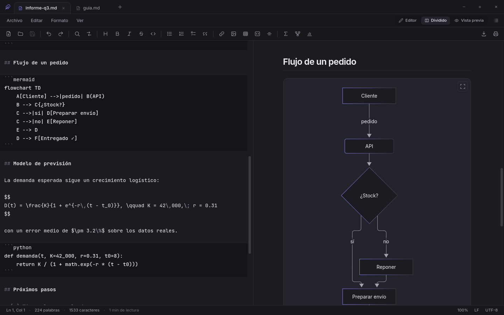
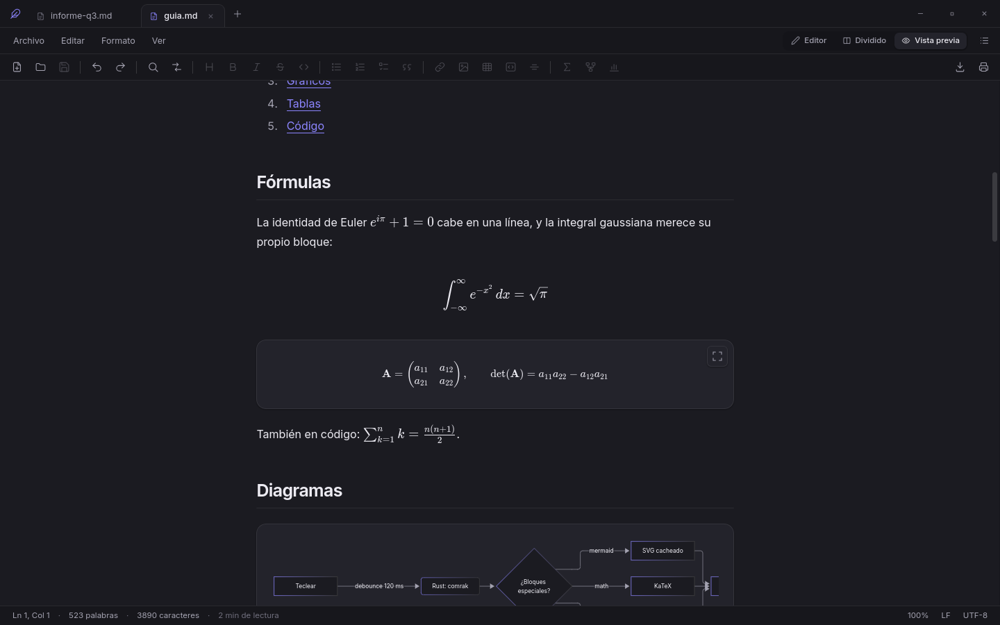
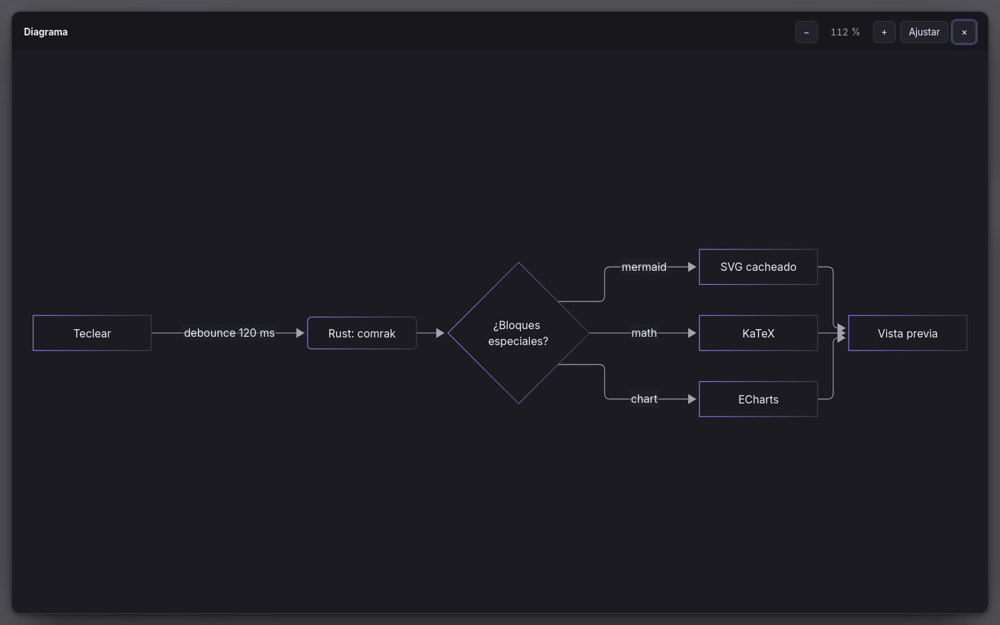
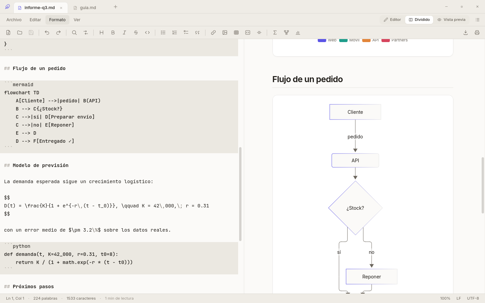
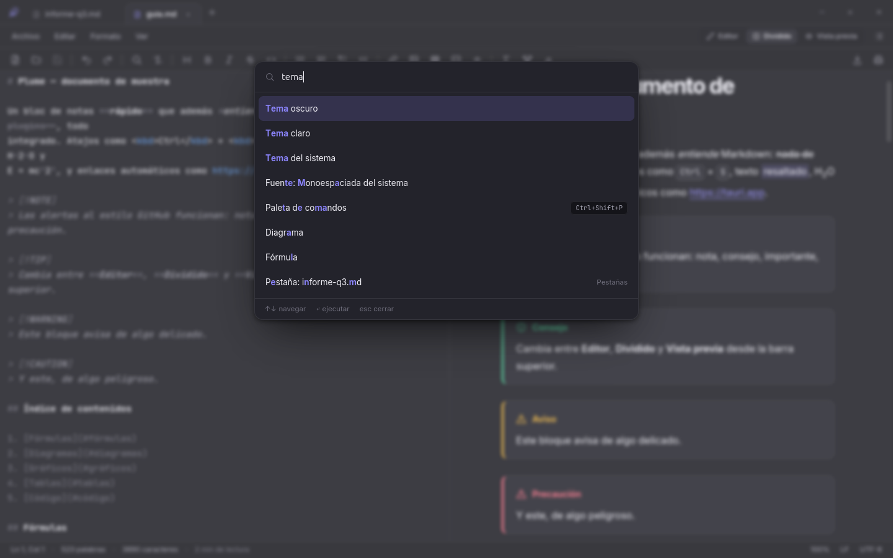
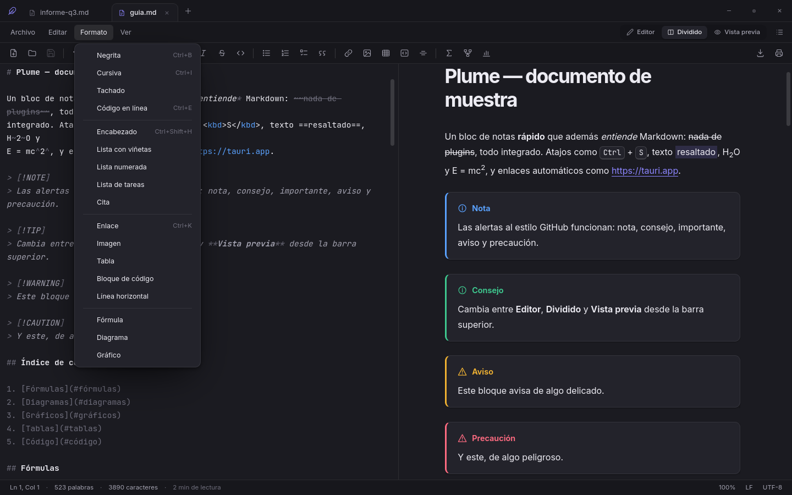

<div align="center">


# Plume

### *El bloc de notas que entiende Markdown*

[](https://www.rust-lang.org)
[](https://tauri.app)
[](https://www.typescriptlang.org)
[](https://codemirror.net)
[](https://mermaid.js.org)
[](https://katex.org)
[](https://echarts.apache.org)
[](LICENSE)

**La sencillez del Bloc de notas de Windows, con una vista previa de Markdown que dibuja diagramas, fórmulas, gráficos y tablas mientras escribes. Nativo, ligero, sin conexión y open source.**

</div>

---



## ✨ Escribe a la izquierda, míralo a la derecha

Plume abre cualquier fichero de texto al instante, como un bloc de notas de toda la vida. Cuando el fichero es Markdown, la vista previa se actualiza sola en cada tecla:
el código va resaltado, los bloques ` ```mermaid ` se convierten en diagramas, el LaTeX en fórmulas y un JSON de diez líneas en un gráfico interactivo.

<div align="center">



</div>

## 🧭 Qué puedes hacer

| | |
|:---:|:---:|
|  |  |
| **Gráficos estadísticos** — barras, líneas, áreas, circular, dispersión y radar con un JSON mínimo, o cualquier opción de ECharts. | **Diagramas** — flujo, secuencia, Gantt, clases, estados… todo Mermaid, con los colores del tema. |
|  |  |
| **Fórmulas** — LaTeX en línea con `$…$` o en bloque con `$$…$$` y ` ```math `, dibujado con KaTeX. | **Visor con zoom** — cualquier diagrama o gráfico se abre a pantalla completa, con zoom y desplazamiento. |
|  |  |
| **Tema claro y oscuro** — sigue al sistema o elige tú. Los diagramas y gráficos cambian con él. | **Paleta de comandos** — <kbd>Ctrl</kbd>+<kbd>Shift</kbd>+<kbd>P</kbd> y escribe lo que quieres hacer. |

<div align="center">



**Barra de herramientas y menú Formato** — negrita, listas, tablas, enlaces, fórmulas, diagramas y gráficos a un clic, con plantillas listas para rellenar.

</div>

## 🧰 Funciones

<table>
<tr>
<td width="50%" valign="top">

**Editor**

- Pestañas múltiples, con sesión restaurada al reabrir
- Tres modos: **Editor**, **Dividido** y **Vista previa** (<kbd>Ctrl</kbd>+<kbd>1</kbd>/<kbd>2</kbd>/<kbd>3</kbd>)
- Scroll sincronizado entre editor y vista previa
- Buscar y reemplazar con contador, mayúsculas, regex y palabra completa
- Ir a línea, multicursor, deshacer ilimitado por pestaña
- Zoom de 50 % a 200 % (<kbd>Ctrl</kbd>+rueda o desde la barra de estado)
- Ajuste de línea y números de línea conmutables
- Ficheros de varios MB: abre 6 MB en menos de un segundo

</td>
<td width="50%" valign="top">

**Vista previa**

- GFM completo: tablas, tareas, tachado, notas al pie, autoenlaces
- Alertas al estilo GitHub (`> [!NOTE]`, `[!TIP]`, `[!WARNING]`…)
- Código resaltado con botón de copiar
- Diagramas **Mermaid**, fórmulas **KaTeX**, gráficos **ECharts**
- Imágenes locales relativas al documento
- Exportar a **HTML** autocontenido e **imprimir/PDF** (siempre en claro)
- HTML incrustado saneado: sin scripts ni manejadores

</td>
</tr>
<tr>
<td valign="top">

**Ficheros**

- Detección de codificación (UTF-8, UTF-16, Windows-1252…) y BOM
- Respeta LF / CRLF y permite cambiarlos desde la barra de estado
- Guardado atómico: un corte de luz no deja el fichero a medias
- Recarga automática si el fichero cambia fuera de Plume
- Arrastrar y soltar, recientes y "Abrir con…" desde el explorador

</td>
<td valign="top">

**Rendimiento**

- Markdown renderizado en **Rust** (comrak + syntect)
- 10 000 líneas en **~9 ms**
- Arranque en **~200 ms**
- Mermaid, KaTeX y ECharts se cargan solo si el documento los usa
- Diagramas y fórmulas en caché: solo se redibuja lo que cambia
- 100 % offline: ni CDN ni telemetría

</td>
</tr>
</table>

## ✍️ Así se escribe

````markdown
> [!TIP]
> Todo esto es Markdown plano: se lee bien en cualquier editor.

La demanda sigue una logística: $D(t) = \frac{K}{1 + e^{-r(t - t_0)}}$


```chart
{
  "type": "bar",
  "labels": ["Lun", "Mar", "Mié", "Jue", "Vie"],
  "series": { "Notas": [3, 7, 4, 9, 6], "Tareas": [5, 4, 6, 7, 8] }
}
```
````

El bloque ` ```chart ` acepta `bar`, `line`, `area`, `pie`, `scatter` y `radar` con ese formato corto, o cualquier [opción de ECharts](https://echarts.apache.org/en/option.html) completa con ` ```echarts `.
Tienes dos documentos de ejemplo en [`docs/muestra.md`](docs/muestra.md) y [`docs/ejemplos/informe-q3.md`](docs/ejemplos/informe-q3.md).

## 🚀 Instalación

### Ubuntu / Debian (paquete `.deb`)

```bash
git clone https://github.com/carlos-anpr/plume.git
cd plume && npm install
npm run tauri build -- --bundles deb
sudo apt install ./src-tauri/target/release/bundle/deb/Plume_*_amd64.deb
```

### Sin sudo (solo para tu usuario)

Compila, instala en `~/.local`, añade Plume al cajón de aplicaciones y lo registra en *Abrir con…* para `.md` y `.txt`:

```bash
./scripts/instalar-local.sh
```

### Requisitos para compilar

- [Rust](https://rustup.rs) 1.85+ y Node.js 20+
- Linux: `libwebkit2gtk-4.1-dev`, `libgtk-3-dev`, `libsoup-3.0-dev`, `librsvg2-dev` ([guía de Tauri](https://tauri.app/start/prerequisites/))
- Windows y macOS: Plume compila con las mismas órdenes gracias a Tauri, pero solo se ha probado en Linux.

## ⌨️ Atajos

| Archivo | | Edición | | Formato | |
|---|---|---|---|---|---|
| Nuevo | <kbd>Ctrl</kbd>+<kbd>N</kbd> | Buscar | <kbd>Ctrl</kbd>+<kbd>F</kbd> | Negrita | <kbd>Ctrl</kbd>+<kbd>B</kbd> |
| Abrir | <kbd>Ctrl</kbd>+<kbd>O</kbd> | Reemplazar | <kbd>Ctrl</kbd>+<kbd>H</kbd> | Cursiva | <kbd>Ctrl</kbd>+<kbd>I</kbd> |
| Guardar | <kbd>Ctrl</kbd>+<kbd>S</kbd> | Ir a línea | <kbd>Ctrl</kbd>+<kbd>G</kbd> | Código | <kbd>Ctrl</kbd>+<kbd>E</kbd> |
| Guardar como | <kbd>Ctrl</kbd>+<kbd>Shift</kbd>+<kbd>S</kbd> | Siguiente | <kbd>F3</kbd> | Enlace | <kbd>Ctrl</kbd>+<kbd>K</kbd> |
| Cerrar pestaña | <kbd>Ctrl</kbd>+<kbd>W</kbd> | Paleta | <kbd>Ctrl</kbd>+<kbd>Shift</kbd>+<kbd>P</kbd> | Encabezado | <kbd>Ctrl</kbd>+<kbd>Shift</kbd>+<kbd>H</kbd> |
| Imprimir / PDF | <kbd>Ctrl</kbd>+<kbd>P</kbd> | Zoom | <kbd>Ctrl</kbd>+<kbd>+</kbd> / <kbd>-</kbd> / <kbd>0</kbd> | Esquema | <kbd>F9</kbd> |

## 🏗️ Cómo está hecho

<p align="center">
  <picture>
    <source media="(prefers-color-scheme: dark)" srcset="docs/arquitectura-dark.svg">
    
  </picture>
</p>

- **Rust** (`src-tauri/`): render Markdown, saneado del HTML, lectura y escritura con detección de codificación, vigilancia de cambios, ajustes y recientes.
- **Interfaz** (`src/`): TypeScript sin framework sobre el webview del sistema. El paquete final ocupa unos 7 MB.
- Contrato y decisiones de diseño en [`docs/ARQUITECTURA.md`](docs/ARQUITECTURA.md).

```bash
npm run tauri dev                                   # desarrollo con recarga
cd src-tauri && cargo test && cargo clippy -- -D warnings
npx tsc --noEmit
```

## 📄 Licencia

[MIT](LICENSE): úsalo, modifícalo y compártelo libremente.
