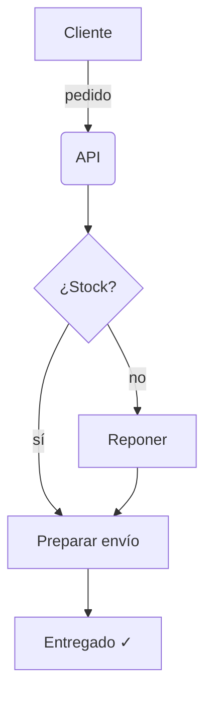

# Informe trimestral · Q3 2026

> [!TIP]
> Este informe está escrito en **Markdown plano**. Los gráficos, diagramas y fórmulas se generan solos.

## Resumen

| Indicador            |   Q2   |   Q3   | Variación |
|:---------------------|-------:|-------:|----------:|
| Usuarios activos     | 18 400 | 24 950 |  **+35 %** |
| Ingresos (k€)        |  412   |  538   |  **+31 %** |
| Tiempo de respuesta  | 182 ms | 121 ms |  **−34 %** |
| Satisfacción (NPS)   |   46   |   58   |   **+12** |

## Evolución mensual

```chart
{
  "type": "bar",
  "labels": ["Abr", "May", "Jun", "Jul", "Ago", "Sep"],
  "series": {
    "2025": [120, 132, 101, 134, 90, 230],
    "2026": [150, 182, 191, 234, 290, 330]
  }
}
```

## Reparto por canal

```chart
{
  "type": "pie",
  "labels": ["Web", "Móvil", "API", "Partners"],
  "series": { "Ventas": [46, 31, 15, 8] }
}
```

## Flujo de un pedido



## Modelo de previsión

La demanda esperada sigue un crecimiento logístico:

$$
D(t) = \frac{K}{1 + e^{-r\,(t - t_0)}}, \qquad K = 42\,000,\; r = 0.31
$$

con un error medio de $\pm 3.2\%$ sobre los datos reales.

```python
def demanda(t, K=42_000, r=0.31, t0=8):
    return K / (1 + math.exp(-r * (t - t0)))
```

## Próximos pasos

- [x] Migrar la pasarela de pagos
- [x] Reducir la latencia por debajo de 150 ms
- [ ] Lanzar la app de escritorio
- [ ] Abrir la API pública
