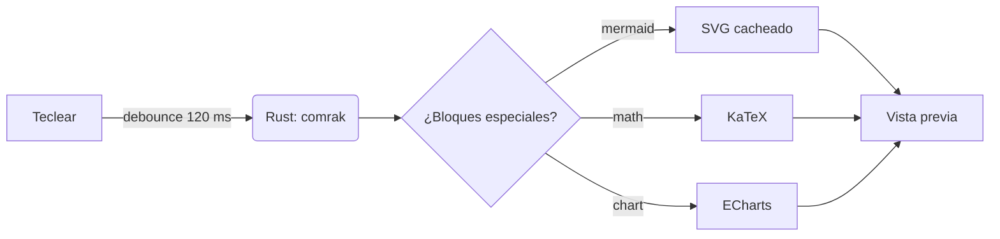
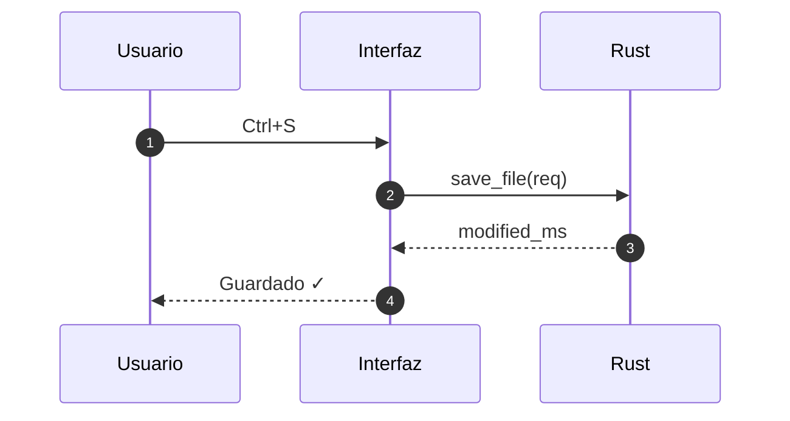
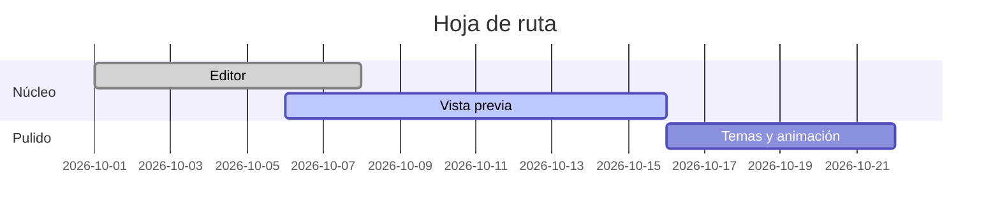

# Plume — documento de muestra

Un bloc de notas **rápido** que además *entiende* Markdown: ~~nada de plugins~~, todo
integrado. Atajos como <kbd>Ctrl</kbd> + <kbd>S</kbd>, texto ==resaltado==, H~2~O y
E = mc^2^, y enlaces automáticos como https://tauri.app.

> [!NOTE]
> Las alertas al estilo GitHub funcionan: nota, consejo, importante, aviso y precaución.

> [!TIP]
> Cambia entre **Editor**, **Dividido** y **Vista previa** desde la barra superior.

> [!WARNING]
> Este bloque avisa de algo delicado.

> [!CAUTION]
> Y este, de algo peligroso.

## Índice de contenidos

1. [Fórmulas](#fórmulas)
2. [Diagramas](#diagramas)
3. [Gráficos](#gráficos)
4. [Tablas](#tablas)
5. [Código](#código)

## Fórmulas

La identidad de Euler $e^{i\pi} + 1 = 0$ cabe en una línea, y la integral gaussiana
merece su propio bloque:

$$
\int_{-\infty}^{\infty} e^{-x^2}\,dx = \sqrt{\pi}
$$

```math
\mathbf{A} = \begin{pmatrix} a_{11} & a_{12} \\ a_{21} & a_{22} \end{pmatrix},\qquad
\det(\mathbf{A}) = a_{11}a_{22} - a_{12}a_{21}
```

También en código: $`\sum_{k=1}^{n} k = \frac{n(n+1)}{2}`$.

## Diagramas







## Gráficos

```chart
{
  "type": "bar",
  "labels": ["Ene", "Feb", "Mar", "Abr", "May", "Jun"],
  "series": {
    "2025": [120, 132, 101, 134, 90, 230],
    "2026": [150, 182, 191, 234, 290, 330]
  }
}
```

```chart
{
  "type": "pie",
  "labels": ["Rust", "TypeScript", "CSS", "Otros"],
  "series": { "Líneas": [48, 34, 14, 4] }
}
```

```echarts
{
  "title": { "text": "Latencia de render (ms)" },
  "tooltip": { "trigger": "axis" },
  "xAxis": { "type": "category", "data": ["1k", "2k", "5k", "10k", "20k"] },
  "yAxis": { "type": "value" },
  "series": [
    { "name": "p50", "type": "line", "smooth": true, "data": [1.2, 2.1, 5.3, 11, 23] },
    { "name": "p95", "type": "line", "smooth": true, "areaStyle": {}, "data": [2.0, 3.4, 8.1, 17, 36] }
  ]
}
```

## Tablas

| Función            | Atajo              | Estado |
|:-------------------|:------------------:|-------:|
| Nuevo              | `Ctrl+N`           |     ✅ |
| Abrir              | `Ctrl+O`           |     ✅ |
| Guardar como       | `Ctrl+Shift+S`     |     ✅ |
| Paleta de comandos | `Ctrl+Shift+P`     |     ✅ |
| Exportar a PDF     | `Ctrl+P`           |     🚧 |

## Código

```rust
use std::sync::LazyLock;

static SYNTAX: LazyLock<SyntaxSet> = LazyLock::new(SyntaxSet::load_defaults_newlines);

pub fn render(source: &str) -> String {
    let mut opts = comrak::Options::default();
    opts.extension.table = true;
    comrak::markdown_to_html(source, &opts)
}
```

```typescript
const preview = createPreview(document.querySelector("#preview")!);
await preview.update(await ipc.renderMarkdown(text), baseDir);
```

## Listas

- [x] Editor con pestañas
- [x] Vista previa sincronizada
- [ ] Exportar a PDF
  - [ ] Saltos de página

Término
: Definición del término con *detalle*.

<details>
<summary>Más información</summary>

Contenido plegable con **Markdown** dentro.

</details>

Una nota al pie[^1] y otra[^larga].

---

[^1]: Las notas al pie se numeran solas.
[^larga]: Y pueden tener varias líneas de texto.
